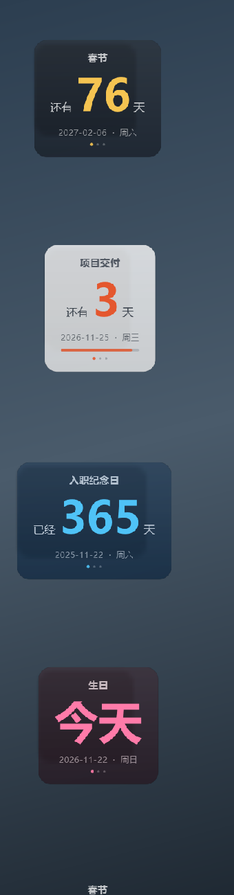

# 桌面倒计日 · CountDay

一个仿 [CountBoard](https://github.com/Gaoyongxian666/CountBoard) 的 Windows 桌面倒计日小工具：
半透明圆角卡片贴在桌面最底层，随时能看到「还有多少天」，不挡任何窗口，支持开机自启。

技术栈：Python + PySide6（Qt 自绘），Win32 API 处理窗口层级与自启，PyInstaller 打包为单文件 exe。

---

## 快速开始

1. 到 [Releases](../../releases/latest) 下载 `CountDay.exe`（单文件，免安装，无需 Python 环境）。
2. 双击运行。卡片默认落在屏幕右上角；按住左键可拖动，靠近屏幕边缘会自动吸附。
3. **右键卡片** → 「设置…」→「事件」页把你的日子加进去。
4. 「行为」页勾选「开机自动启动」，之后随开机静默出现。
5. 退出：右键卡片或托盘图标 →「退出」。只想暂时不看见就选「隐藏卡片」。

配置与状态保存在 `%APPDATA%\CountDay\config.json`（纯 JSON，可手改；程序会校验并补全字段）。

## 效果



同一套渲染，7 个主题预设：曜石黑 / 霜白 / 深海蓝 / 薄荷绿 / 樱粉 / 纸感浅灰 / 极简透明。

## 界面与交互

- 卡片内容：事件名 / 「还有 128 天」 / 目标日期与星期，可选进度条与轮播页码点。
- 左键拖动移动，位置自动记忆并保证不跑出屏幕；**双击**直接编辑当前事件；**滚轮**切换事件。
- 右键菜单：编辑此事件、新建事件、上一个/下一个事件、锁定位置、开机自启、设置、隐藏、退出。
- 托盘图标：单击显示/隐藏卡片，右键有完整菜单。
- 多个事件时按设定间隔自动轮播（淡入淡出），底部小圆点指示第几个。

## 核心特性

| 特性 | 说明 |
| --- | --- |
| 桌面置底 | `SetWindowPos(HWND_BOTTOM)` + `WS_EX_NOACTIVATE`：永远压在所有窗口之下，点它不会抢走当前窗口焦点，也不出现在任务栏与 Alt+Tab |
| 抗「显示桌面」 | 监听最小化并立刻恢复，Win+D 之后卡片依旧在桌面上（实测 z 序始终紧贴桌面窗口之上） |
| 开机自启 | 勾选后写入 `HKCU\Software\Microsoft\Windows\CurrentVersion\Run`，不需要管理员权限 |
| 倒计日 / 纪念日 | 倒计时显示「还有 N 天」，当天显示「今天」，过期显示「已过 N 天」；纪念日显示「已经 N 天」 |
| 两种算法 | 自然日（明天就是 1 天）/ 紧迫（满 24 小时才算 1 天） |
| 外观自定义 | 7 套预设 + 背景/文字/强调色任取、透明度、圆角、字体、字号、数字放大倍率、对齐、显示项开关 |
| 当天提醒 | 到期当天由托盘弹出气泡提醒 |
| 单实例 | 重复启动只唤醒已有实例（本地 socket 转发），不会开两个 |
| 多屏 | 位置按可用工作区夹取，拖到哪块屏就记在哪块屏 |

## 从源码运行

```bash
pip install PySide6-Essentials pyinstaller pillow
python main.py
```

开发辅助：

```bash
python main.py --reset        # 恢复默认配置
python main.py --demo-menu    # 启动后自动弹出右键菜单（调样式用）
python tools/preview.py out.png            # 离屏渲染卡片效果图
python tools/preview_dialogs.py            # 离屏渲染设置面板/事件对话框
```

## 打包

```bash
python build.py            # dist/CountDay.exe（单文件，约 35 MB）
python build.py --onedir   # dist/CountDay/CountDay.exe（启动更快）
python build.py --icon     # 只重新生成图标
```

## 文件说明

```
main.py        入口：控制器、托盘、菜单、定时器、单实例
card.py        卡片窗口：无边框透明 + QPainter 自绘 + 拖动/右键/轮播淡入淡出
countdown.py   日期计算与文案（自然日/紧迫、倒计日/纪念日）
config.py      配置默认值与 JSON 读写（%APPDATA%\CountDay）
dialogs.py     事件编辑对话框 + 设置面板（事件/外观/行为三页）
theme.py       外观预设
win_utils.py   Win32：置底/置顶、不抢焦点、抢前台、开机自启注册表
build.py       图标生成 + PyInstaller 打包
tools/         开发预览脚本（卡片效果图、设置面板效果图）
```

## 已知取舍

- **「桌面置底」用置底窗口实现，而不是把窗口 SetParent 到 WorkerW 壁纸层。** 后者虽然真的“贴在壁纸上”，但会被桌面图标层（SHELLDLL_DefView）挡住、收不到鼠标事件 —— 拖不动、右键也没反应。置底窗口能同时保留每像素透明和完整交互，视觉上同样是“其他窗口都在它上面”。
- 背景不透明度 ≤3% 时自动省略背景与投影，只留文字（对应「极简透明」预设）。
- 已过期的倒计时不会自动删除，会显示「已过 N 天」，方便回头看他过去多久。
- 仓库里不放 exe（35 MB 会让每次改代码都撑大历史），发行版见 Releases。

## 许可证

[MIT](LICENSE)
